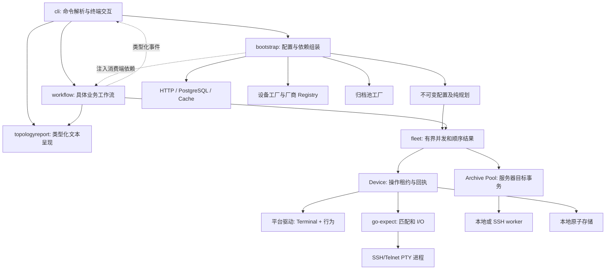
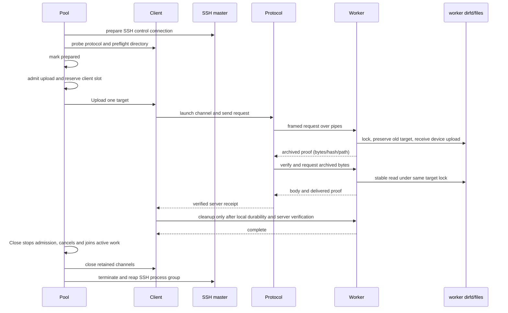

# 所有权与执行边界

Driver 提供终端语法（Terminal）与需要代码的厂商行为（配置采集、保存确认、可选命令/登录钩子）；Device 拥有当前会话和操作租约。transport 拥有进程组，expect 拥有单一输入泵。Topology 的发现、重验、修改、读回和保存共用一次租约。每次归档的目标锁覆盖旧文件保留、服务器时钟标记、设备上传、核验、双端持久化和清理。

## 应用组合与呈现

`internal/cli` 拥有 Cobra 命令树、参数转换、交互、退出码和终端文字。它把明确的命令意图交给 `internal/bootstrap`，由后者负责配置加载、命令默认值、备份策略、缓存模式、拓扑策略校验和依赖组装。Bootstrap 将配置快照转换成 `workflow.Runtime`、`TFTPSettings`、`TopologySettings`；工作流不读取配置键，也不解析命令参数。拓扑 apply 需要明确的 apply 命令，配置中的 mode 不能把 plan 提升为写操作。凭据仍在设备或归档资源实际构造时读取。

`internal/workflow` 拥有业务步骤、报告持久化、保留证据和错误收尾。它通过串行的类型化 `Event` 回调报告计划、阶段、会话元数据和结果；`internal/cli` 将事件映射到 `progress.Reporter`，工作流不依赖终端 Reporter 或中文显示函数。回调失败会保留并在最终报告中降低成功状态；已确认的设备步骤、归档证明和存储回执继续保留，不重放设备写入。命令最终输出失败仍通过 `RecordOutputFailure` 回写报告。

所有业务命令共用 `internal/workflow` 的单设备阶段流水线：`Operation` 是 `Stage` 的有序组合，`Runner.Execute` 负责并发与稳定顺序、会话（`Session` 在首次使用时打开并认证，认证失败记为 authenticate 阶段）、首个失败即拦截后续阶段、`StopAfterFailures`、取消时 `not_started`/`interrupted`，以及 `plan.json`、`events.jsonl`、`report.json` 的写入。拓扑 apply 通过 `Operation.Then` 第二轮实现：第一轮全部审计结束并写好 `scripts/` 与 `topology-plan.json` 后才准入应用。报告契约（schema v3）由叶子包 `internal/batchreport` 拥有，导出与 diff 经 `storage.ReadBatchSaved` 读取并校验。CLI 每个业务命令是一个 `useCase`（离线 `prepare` + `run`），共享配置 → 凭据 → 装配 → 清单 → 执行 → 呈现管线。

共享清单配置由公开 `config.InventoryEnvironment` 与 `config.ValidateInventory` 处理，只接受 `netdisco` / `inventory` 范围，并复用 config 内部同一份字段定义和解码器。环境投影先按高优先级字段的存在性屏蔽，再解析剩余值；false、null、空列表和替换父节都属于明确覆盖。纯校验不发现文件、不解析路径、不补默认值，也不读取凭据，业务程序仍拥有自己的文件与参数入口。

文件输入边界统一为 `config.ReadFile(ctx, path, missingOK)`：跟随可读符号链接，只接纳 16 MiB 以内普通文件，使用非阻塞打开拒绝 FIFO，分块同步读取并在边界检查取消。失败不交付部分正文，文件错误不包含路径或内容；取消原因可由 `errors.Is` 判断。`ParseYAML` 与要求显式根映射的 `ParseYAMLMapping` 共用严格解析与资源预算。各应用继续拥有 schema、文件发现和覆盖策略。Connector 的 `LoadContext` 在发现、各层解码与最终返回前传播调用方 context；旧 `Load` 只作兼容。上下文检查不承诺中断阻塞的文件系统调用。

`scripts/check-architecture.py` 从 `GOWORK=off go list -json ./...` 的实际生产包和传递依赖检查边界：公开库不依赖 cmd、bootstrap、CLI 或 workflow；通用 connector 不选择 vendors；bootstrap 不依赖 CLI；workflow 不反向依赖 bootstrap、CLI 或进度 Reporter。规则按完整包路径及其子包匹配，允许既有纯呈现、存储和厂商能力依赖，测试专用导入不计入生产边界。CI 同时运行临时 Go 模块负例，验证嵌套包、间接导入和解析失败不能绕过规则。

## 厂商平台与能力

`vendors.NewBuiltinRegistry()` 是唯一内建平台目录。目录项是 `vendors/<family>` 家族包中的具体平台对象；每个对象就是一个 `connector.Driver`，`Terminal()` 返回独立副本。`platform` 包只放 `Platform`、`Registry`、`Identity` 和诊断错误；能力接口及其数据类型（`topology.Neighbor`、`transfer.TFTPOptions` 等）由消费包定义；`topology`、`transfer`、`fleet` 各自拥有消费端行为接口。家族对象只组合真实支持的接口，例如 Radware 提供描述读取和接口身份映射，不虚报邻居发现或描述写入。每个家族包集中组织 `platform.go`、`inventory.go`、`configuration.go`、`topology.go` 和传输策略。H3C/H3C Wireless 与 Cisco IOS/NX-OS 共享家族实现，同时保留独立平台类型和平台覆盖。

登录/命令提示符、分页、错误签名、交互回复、配置命令、保存签名和身份匹配都由家族包拥有。共享 `vendors/internal/driver` 提供 `driver.Base`（Terminal 持有、配置采集工厂、正向保存确认）、拓扑委托、保存回执校验和 TFTP 骨架。配置采集策略负责平台模式切换、差异校验和文本清理；缺少已知正向签名时保存结果保持未确认。`vendors/internal/topology` 只执行通用 TextFSM 解析和结果校验；模板选择、记录计数和配置完整性规则与平台同包。接口名规范化由 `internal/ifname` 单一实现。TFTP 的命令、来源文件发现、完成证据及回执元数据也由家族包负责。`MatchInventory` 是 `platform.Platform` 的一部分，Registry 从同一有序平台清单生成键查找表与匹配顺序，fleet 仅依赖自己的 resolver 接口，保留用户覆盖优先顺序。

`fleet.NewRules`、Topology 构造与纯计划函数、transfer API（包括 TFTP 和远程配置导出）都接收显式 `platform.Registry`。Bootstrap 只在组合根创建一次目录并注入调用方，避免包级平台/名称查询和全局运行时插件状态。扩展新平台时需同时声明能力、连接档案以及该平台实际支持的可选行为；没有证据的能力保持不支持。

解析错误通过 `platform.DiagnosticError` 携带稳定 code/phase，再由消费者转换为自己的领域错误。通用解析失败映射为 `unrecognized_output`；平台有明确证据时保留更具体的错误码，例如 Fortinet VDOM 不一致。诊断文本只包含元数据，不包含设备原始输出。

新增平台的业务流程、文件职责、内建识别顺序和验收清单见 [`vendors/README.md`](../vendors/README.md)。

命令回执必须已经匹配提示符且未被设备拒绝。回执在日志收尾、hook 和观察者回调之前登记。原文必须显式读取；默认格式化只显示安全元数据。敏感交互采用操作范围的脱敏规则，不把密码交给全局状态。

`Result.SingleAccepted` 集中校验唯一 accepted 主命令与精确命令身份；hook 尝试仍由 `Attempts` 保存。它不替代执行错误判断，晚到错误与已接受步骤可以同时存在。`StepResult.Body` 只从严格验证过的不可变文本中移除确认提示符和首行匹配回显，保留缩进、正文中的同名命令与所有末尾分隔换行；提示符匹配的前导换行属于正文分隔符。缺少严格文本、提示符不一致及备份专用保真视图返回安全的 `ErrInvalidResult` 错误，原转换原因仍可解包。厂商多步骤配置选择、Clean、保存签名及原始证据继续各自拥有业务语义，不复用正文接口改变清理规则。

本地备份的 `Change` 表示内容关系；`File.State` 表示本次写入是否提交/持久化。只有实际核验同一私有文件并跳过写入时才设置 `NoWriteVerified`。内容相同但替换失败不属于已保存文件。

TFTP 的设备报告和服务器核验分开保存。配置源文件发现和设备上传共享同一个上传期限；单条设备命令期限受该总期限约束。远端正文写本地磁盘失败时仍按同一绝对期限读完并校验正文/尾帧，保留可确认哈希；不会重传。清理服务器暂存文件需要服务器归档和本地文件均已确认。失败或断线会保留尚未确认的暂存文件。

批次报告的持久化 schema 由 `internal/batchreport` 明确拥有，Fleet 写入时使用同一 schema 版本；`storage` 负责打开已选批次目录、锚定读取与文件哈希核验，不在存储实现中内嵌 Fleet 报告结构。

Archive Pool 每个 SSH 主连接最多 4 个通道，总槽位不超过批次并发。Prepare 预检全部主连接、协议版本、能力和目录；Close 可以取消并加入正在预检的任务，随后回收已接纳任务及进程组。worker 的路径遍历使用固定目录 FD、openat/NOFOLLOW、所有者/权限/链接数/文件身份检查。目标锁使用 NFC 与 case-fold 规范化键，防止大小写或 Unicode 别名交错上传。

Pool 唯一负责并发接纳、预检协调和批次关闭；Client 拥有一次目标事务及其通道清理；Protocol 拥有帧顺序并消费 Client 明确提供的阶段 context；worker 拥有目录 FD、文件身份、目标锁和服务端目标回执。设备只报告传输完成时回执仍是 `device_reported`；只有归档 worker 返回的正文与尾帧都匹配字节数和 SHA-256 后才成为 `server_verified`。本地持久化或清理失败保留已获得的证据，但不会重新上传。

HTTP/PG 来源拥有各自请求/连接，返回整份有效清单或错误；不交付半页结果。Cache 保存 schema1、身份双 SHA-256 和完整清单，来源失败时可显式使用已校验旧缓存。Fleet 在库存顺序输出结果，取消后停止接纳新任务并等待已接纳任务退出。

配置和纯计划不打开设备，不查询设备凭据。批次预检覆盖所有有能力的设备，抽样不能隐藏无效策略。主机过滤以地址区间比较，不展开 IPv4/IPv6 网段。历史质量证据用于审计，不参与当前构建；go-expect 通过正式发布模块解析。

响应处理区分原始字节、解码正文与可见文本；完成步骤复用不可变渲染结果。分页剥离首次发生时才分离正文缓冲。无回显日志仅保留预算计数与安全事件元数据。TextFSM 仅缓存内嵌模板的只读编译状态，每次解析复制 Values 并创建独立 ParserOutput；自定义模板不缓存。

## 归档 v2 与统一配置

归档事务 module 的 interface 返回 `archive.Result`：设备报告在 `Transfer`，服务器 `Proof`、本地 `storage.Receipt` 与清理状态在 `Receipt`。Fleet 保存这两份正交证据，不再从一个 verification 值推断本地是否持久化。部分失败后仍保留所有已经确认的事实，清理未确认时不能报批次成功。

Client 为准备、上传、核验、本地提交及清理安排阶段 context；Pool 排队与 Client 准备沿用同一截止点。Launcher 归事务父 context 所有，阶段结束不会销毁仍需使用的 worker。worker 使用同一 v2 预算并在阶段交接控制帧允许固定 10 秒传输余量。正文、尾帧和本地提交共享 Verify 截止点；worker 收到 cleanup 前不会开始清理计时。同步磁盘操作和借用回调仍须合作取消，不以遗弃 goroutine 模拟硬超时。

配置只发现平铺的 `net-connector.yml`，按目录优先级合并同名文件，显式 `--config` 最后加载。`.env` 与来源追踪保持原用途，自动发现不再读取旧用途文件。归档默认期限与 worker 路径在 archive 定义，config 默认输出与 bootstrap 类型化设置复用它们；业务运行时只传递一份 Timeouts。

导出由报告模式决定固定产物位置：backup 在批次根，TFTP 在 `tftp`。报告绝对路径只提供文件名，实际读取锚定用户指定的批次目录，固定子目录和文件都禁止符号链接。搬移整个批次后仍能导出，根目录同名文件不会替代 TFTP 产物。
