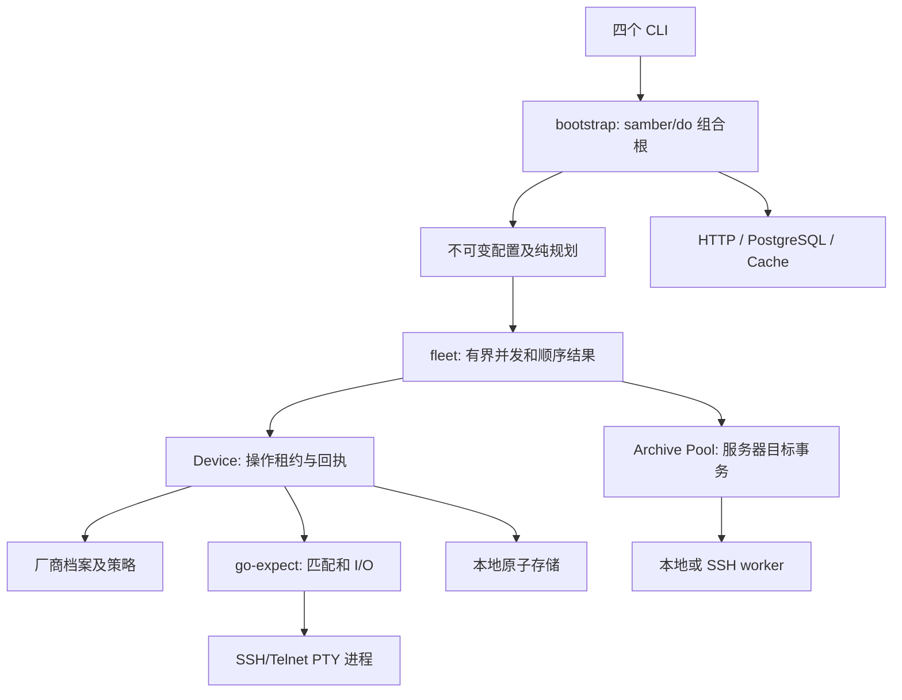

# 所有权与执行边界

Profile 只声明规则；Device 拥有当前会话和操作租约。transport 拥有进程组，expect 拥有单一输入泵。Topology 的发现、重验、修改、读回和保存共用一次租约。每次归档的目标锁覆盖旧文件保留、服务器时钟标记、设备上传、核验、双端持久化和清理。

命令回执必须已经匹配提示符且未被设备拒绝。回执在日志收尾、hook 和观察者回调之前登记。原文必须显式读取；默认格式化只显示安全元数据。敏感交互采用操作范围的脱敏规则，不把密码交给全局状态。

本地备份的 `Change` 表示内容关系；`File.State` 表示本次写入是否提交/持久化。只有实际核验同一私有文件并跳过写入时才设置 `NoWriteVerified`。内容相同但替换失败不属于已保存文件。

TFTP 的设备报告和服务器核验分开保存。远端正文写本地磁盘失败时仍按同一绝对期限读完并校验正文/尾帧，保留可确认哈希；不会重传。清理服务器暂存文件需要服务器归档和本地文件均已确认。失败或断线会保留尚未确认的暂存文件。

Archive Pool 每个 SSH 主连接最多 4 个通道，总槽位不超过批次并发。Prepare 预检全部主连接、协议版本、能力和目录；Close 可以取消并加入正在预检的任务，随后回收已接纳任务及进程组。worker 的路径遍历使用固定目录 FD、openat/NOFOLLOW、所有者/权限/链接数/文件身份检查。目标锁使用 NFC 与 case-fold 规范化键，防止大小写或 Unicode 别名交错上传。

HTTP/PG 来源拥有各自请求/连接，返回整份有效清单或错误；不交付半页结果。Cache 保存 schema1、身份双 SHA-256 和完整清单，来源失败时可显式使用已校验旧缓存。Fleet 在库存顺序输出结果，取消后停止接纳新任务并等待已接纳任务退出。

配置和纯计划不打开设备，不查询设备凭据。批次预检覆盖所有有能力的设备，抽样不能隐藏无效策略。主机过滤以地址区间比较，不展开 IPv4/IPv6 网段。原始源码基线及兼容补丁独立保留，避免把并行工作区变化当成本次改动。

响应处理区分原始字节、解码正文与可见文本；完成步骤复用不可变渲染结果。分页剥离首次发生时才分离正文缓冲。无回显日志仅保留预算计数与安全事件元数据。TextFSM 仅缓存内嵌模板的只读编译状态，每次解析复制 Values 并创建独立 ParserOutput；自定义模板不缓存。
